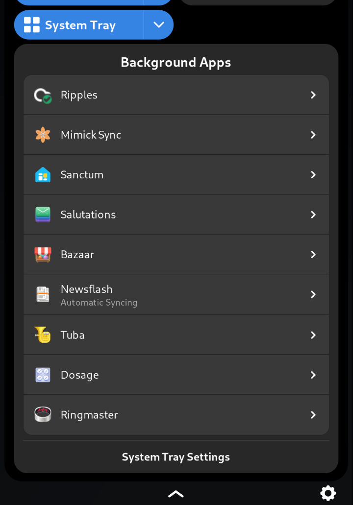
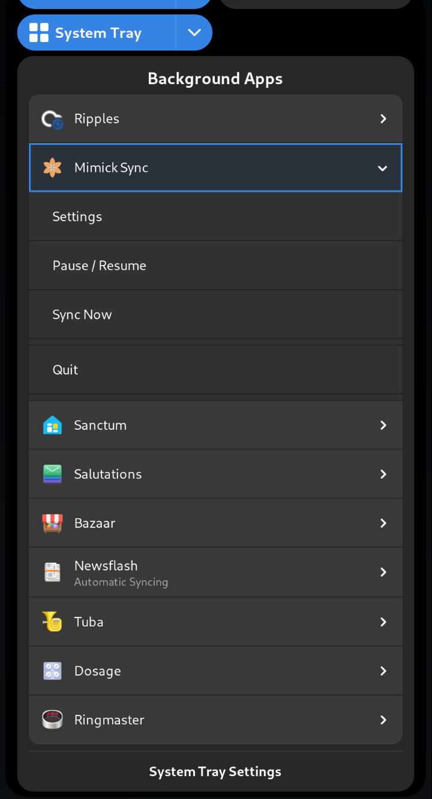
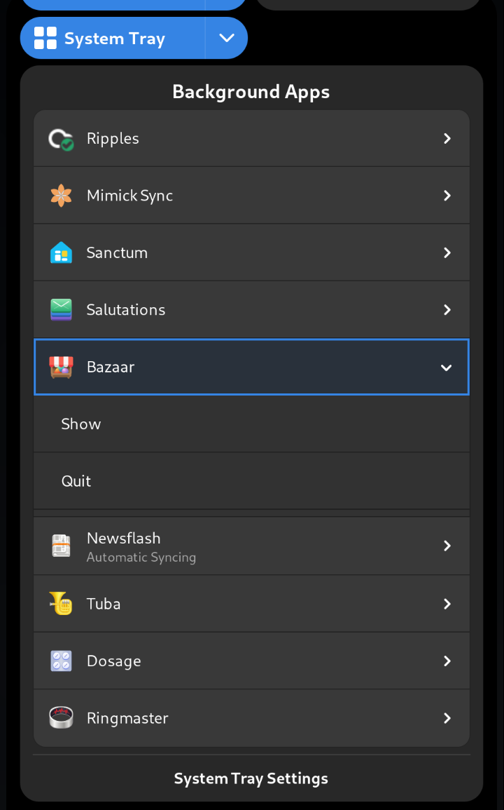
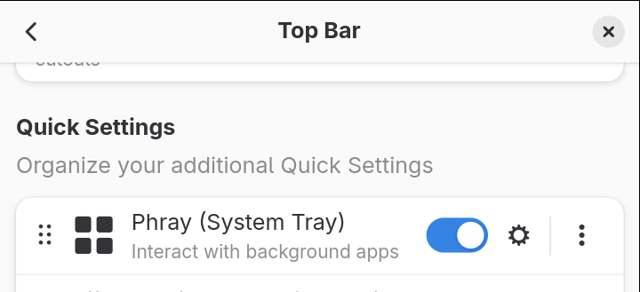
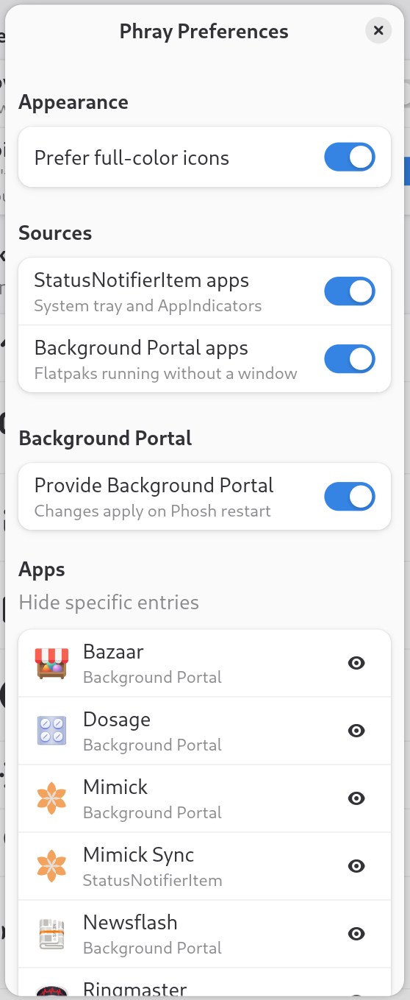

# Phray

A Phosh quick-settings plugin that combines StatusNotifierItem
(KStatusNotifierItem/AppIndicator) tray icons and the GNOME Background Apps
portal into a single tile, bringing desktop-style system tray functionality
to Phosh-based mobile Linux.

Developed and tested on FuriOS (Debian forky, aarch64).

## Features

- Shows StatusNotifierItem tray icons, including their DBusMenu menus.
- Shows apps reported by `org.freedesktop.background.Monitor`, with Show and
  Quit actions.
- Optionally provides `org.freedesktop.impl.portal.Background` itself, for
  systems where no other backend implements it (off by default; applies on
  Phosh restart).
- Settings are available in Mobile Settings.

## Screenshots








## Requirements

- Phosh providing `libphosh-0.45` (built and tested against Phosh 0.58.0).
- Mobile Settings, to open the settings dialog.
- `xdg-desktop-portal`, for the Background Apps source, which reads
  `org.freedesktop.background.Monitor`.

## Building

### Prerequisites

- `libphosh-0.45` and the `phosh-plugins` pkg-config package (Debian:
  `libphosh-0.45-dev`, `phosh-dev`)
- GTK 3 (>= 3.22) and libhandy-1 for the main plugin; GTK 4 and
  libadwaita-1 for the settings plugin
- GLib/GIO (>= 2.68) and gsettings-desktop-schemas (>= 42)
- `wayland-client` and `wayland-scanner`
- meson (>= 0.59), ninja, pkg-config, gettext

`debian/control` lists the Debian build dependencies.

### Compiling

```sh
meson setup builddir
ninja -C builddir
sudo ninja -C builddir install
```

A Debian package can be built with `dpkg-buildpackage`.

Project page: <https://dev.dunevent.net/aj/Phray>

## License

GPL-3.0-or-later. See [LICENSE](LICENSE).
